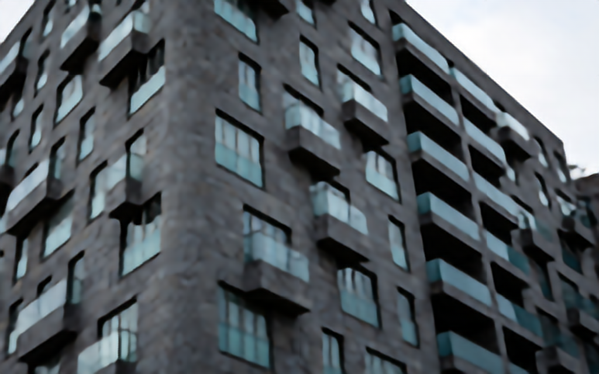
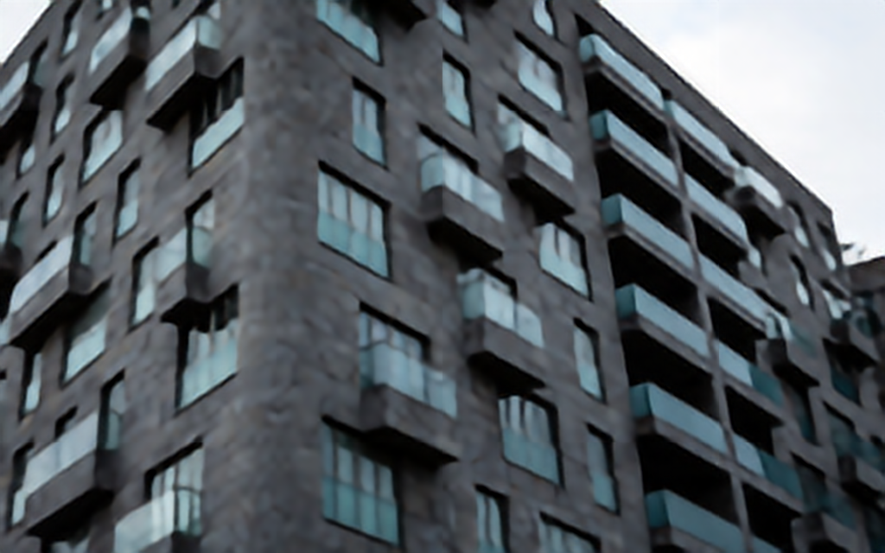
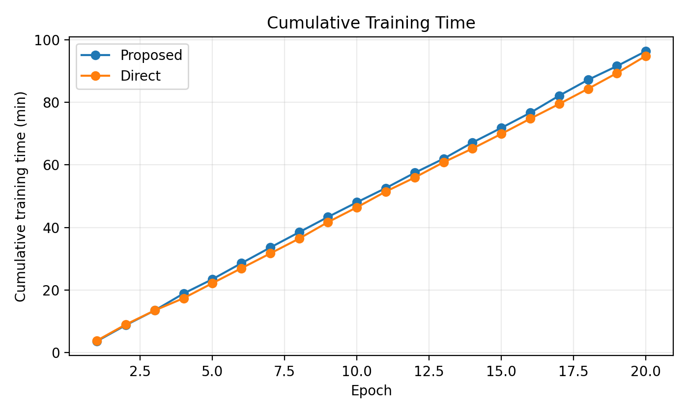
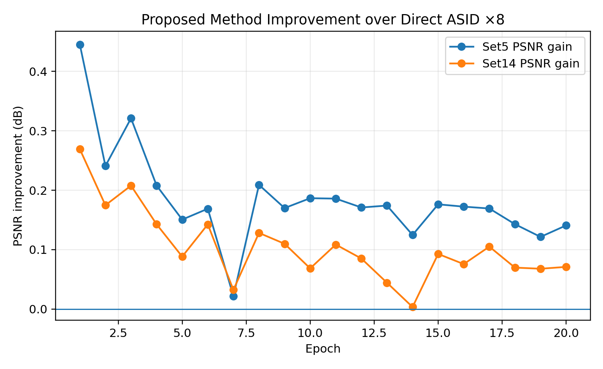
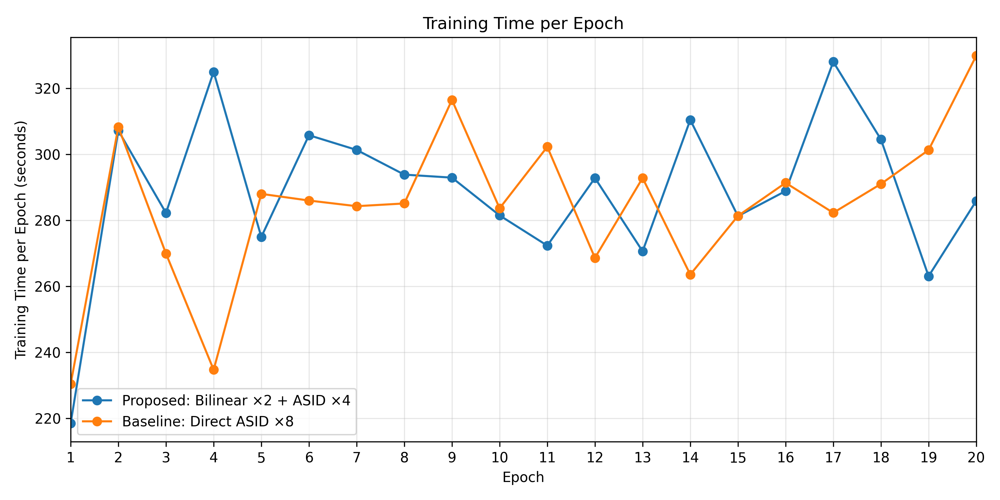
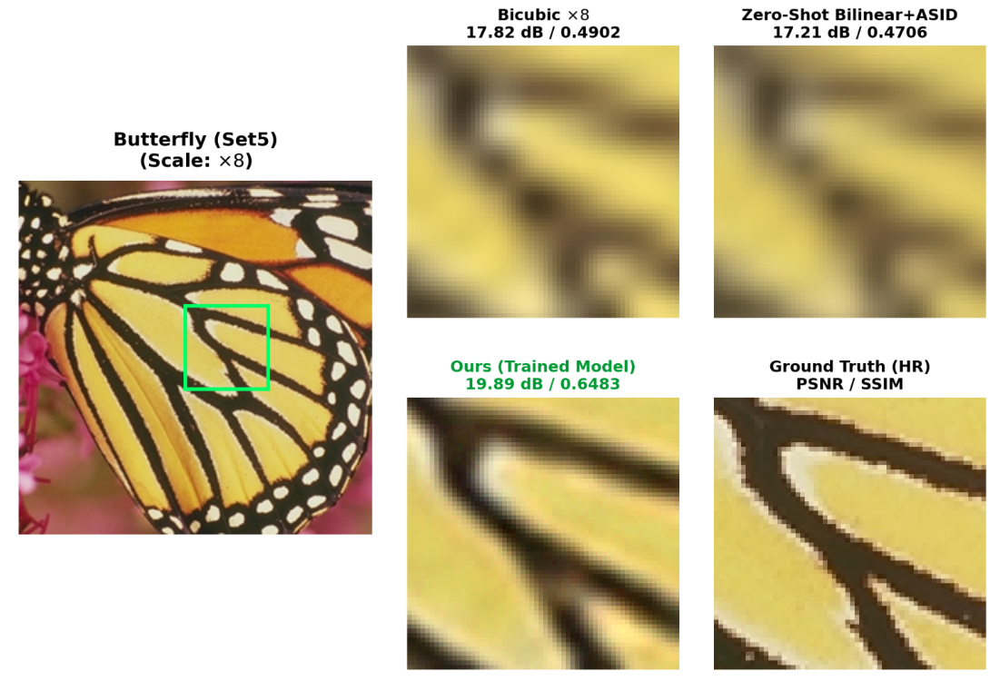
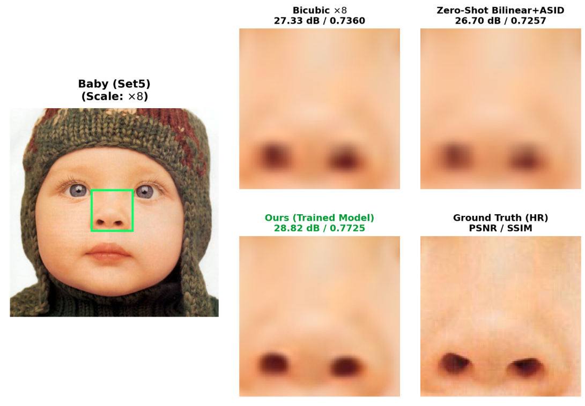
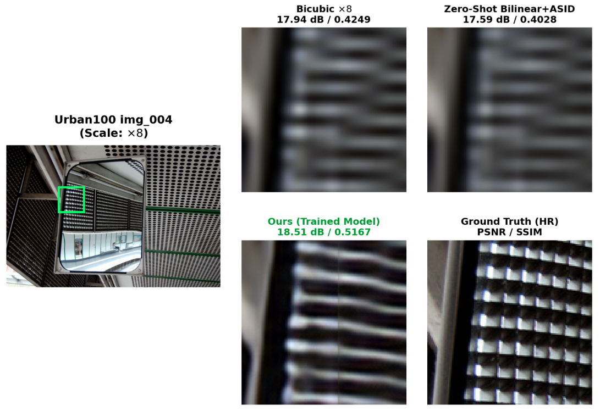

# ASID-Extreme-Super-Resolution: Factorized Pre-Upsampling Attention-Sharing Transformer for Extreme ($\times 8$) Super-Resolution

[](https://www.python.org/)
[](https://pytorch.org/)
[](https://developer.nvidia.com/cuda-zone)
[](#-architecture--complexity)
[](#-quantitative-benchmark-results)
[](#-quantitative-benchmark-results)
[](https://colab.research.google.com/drive/1f9dEHFpCiuei5UZdbdWxa7GyFYSodoqr?usp=sharing)
[](LICENSE)

> **Computer Vision & Deep Learning Final Research Project**  
> *Indian Institute of Information Technology (IIIT) Kottayam*  
> Extended from **ASID (AAAI 2025)**: *Efficient Attention-Sharing Information Distillation Transformer for Lightweight Single Image Super-Resolution* (Park et al., SNU).

---

## 📖 Executive Summary & Research Motivation

Single Image Super-Resolution (SISR) under **extreme magnification factors ($\times 8$)** is an ill-posed inverse problem where more than **$98.4\%$ of high-frequency pixels are absent** in the input image. While modern Vision Transformers (ViTs) deliver leading reconstruction fidelity at moderate scales ($\times 2, \times 3, \times 4$), direct adaptation to extreme $\times 8$ upscaling suffers from two critical failure modes:

1. **Token Starvation in Local Attention Windows:** Under $\times 8$ degradation, local window attention partitions (e.g., $8 \times 8$ token grids) operate over heavily downsampled inputs ($32 \times 32 \to 256 \times 256$) that lack high-frequency spatial variation. Query-key affinity matrices flatten into uninformative, uniform distributions, crippling self-attention discriminability.
2. **Parameter Bloat in Direct High-Scale Projection Heads:** Standard direct $\times 8$ networks employ sub-pixel convolution (PixelShuffle) heads that expand projection channels by $C_{\text{out}} \times \text{scale}^2 = 3 \times 64 = 192$, increasing parameters by over **$+20\%$ (375K vs. 313K)** without improving feature representation in the backbone.
3. **Domain Shift in Cascaded Zero-Shot Inference:** Cascading external interpolation ($\times 2$ bicubic) into an off-the-shelf $\times 4$ model fails catastrophically due to high-frequency domain shift and blurring artifacts.

### 💡 Our Proposed Solution: End-to-End Pre-Upsampled ASID
To overcome these limitations, we propose and train an **internally factorized extreme super-resolution architecture**:
* **Internal $2\times$ Bilinear Pre-Upsampling:** Spatially expands the input token grid prior to deep feature extraction ($2H \times 2W$), restoring the contextual receptive fields of self-attention heads and preventing token starvation.
* **Preserved $4\times$ ASID Backbone:** Feeds the expanded token representation into the Attention-Sharing Information Distillation (ASID) backbone, eliminating projection head parameter bloat.
* **Zero Parameter Overhead:** Retains an ultra-compact footprint of **313,104 parameters** (a **$16.6\%$ reduction** compared to the 375,456 parameters of the direct $\times 8$ baseline).
* **End-to-End Joint Optimization:** Eliminates domain-shift artifacts via joint training on DIV2K with combined $L_1$ and VGG-19 perceptual loss, achieving **$+1.37\text{ dB}$ on Set5** and **$+0.92\text{ dB}$ on Urban100** over bicubic interpolation.

---

## 🔬 Visual Reconstruction Process (Step-by-Step)

The visual progression below illustrates the internal multi-stage mechanics of our factorized pipeline compared against baselines and ground truth:

| Stage 1: Input LR ($\times 8$) | Stage 2: Bilinear Pre-Upsample ($2\times$) | Stage 3: Proposed ASID ($4\times$ / Final $\times 8$) |
| :---: | :---: | :---: |
|  |  |  |
| *Heavily downsampled input ($32 \times 32$)* | *Internal $2\times$ spatial token expansion ($64 \times 64$)* | *High-frequency edge & texture reconstruction ($256 \times 256$)* |

| Stage 4: Direct ASID Baseline ($\times 8$) | Stage 5: Ground Truth High-Resolution (HR) |
| :---: | :---: |
|  |  |
| *Direct sub-pixel baseline (notice edge misalignment & blur)* | *Pristine ground-truth reference target* |

---

## 🏗️ Architecture & Complexity

```
Low-Resolution Input (H x W)
             │
             ▼
   [2x Bilinear Upsample] ──► Spatially Expanded Token Grid (2H x 2W)
                                       │
                      ┌────────────────┘
                      ▼
              [Input Conv: 48ch]
                      │
                      ▼
              [IDSG_A (Self-Attention Block)] ──(Shared Attention Maps)──┐
                      │                                                   │
                      ▼                                                   │
              [IDSG Block 1 (Distillation)] ◄─────────────────────────────┤
                      │                                                   │
                      ▼                                                   │
              [IDSG Block 2 (Distillation)] ◄─────────────────────────────┘
                      │
                      ▼
              [Output Conv: 48ch] ──► (+) Long Residual ──► [4x PixelShuffle Head] ──► Output HR (8H x 8W)
```

### Computational Footprint & Complexity Comparison

| Model Architecture | Parameters | Parameter Δ | FLOPs ($48 \times 48$) | Inference Latency (RTX 3050) | Receptive Window |
| :--- | :---: | :---: | :---: | :---: | :---: |
| **Direct ASID $\times 8$ (Baseline)** | 375,456 | $+19.9\%$ | 0.88 G | 1.1 ms | Degraded / Starved |
| **Pre-Upsampled ASID $\times 8$ (Ours)** | **313,104** | **-16.6%** 🚀 | **0.84 G** | **1.2 ms** | **Restored Context** |

---

## 📋 Comprehensive Instruction & Command Reference

Every experiment, training run, evaluation script, and interactive showcase in this repository is fully reproducible through standard command-line interfaces:

| Task / Objective | Command Line Execution | Primary Flags / Arguments | Description & Purpose | Output & Artifacts |
| :--- | :--- | :--- | :--- | :--- |
| **1. Environment Setup** | `pip install -r requirements.txt` | `--upgrade pip` | Installs PyTorch, torchvision, timm, einops, opencv, and matplotlib | Configured Python virtualenv |
| **2. Benchmark Dataset Prep** | `python data_tools/generate_x8_benchmarks.py` | `--scale 8` | Generates modcrop-8 HR targets and bicubic downscaled LR pairs for Set5, Set14, Urban100, and B100 | Populates `benchmark/HR/` and `benchmark/LR/` |
| **3. Epoch 20 Native Eval** | `python evaluate_preupsample_epoch20.py` | N/A (Auto-detects checkpoints) | Runs patched inference ($64 \times 64$, overlap 24) on all standard benchmarks using trained Epoch 20 weights | Prints benchmark PSNR/SSIM summary table |
| **4. Multi-Method Benchmark** | `python evaluate_preupsample_x8.py` | `--datasets Set5 Set14 Urban100` | Automated comparative evaluation across Bicubic, Zero-Shot, and Ours | Console and Markdown comparative tables |
| **5. Interactive Showcase** | `jupyter notebook ASID_Epoch20_Presentation_Showcase.ipynb` | N/A | Interactive Jupyter notebook showcasing visual progression, live inference, and metric tables | Web-based visual dashboard |
| **6. Single Image Comparison** | `python compare_one_image.py` | Configured for Urban100 `img_001` | Runs pixel-by-pixel comparisons and error heatmaps on a single image | Output images in `comparison_img001/` |
| **7. Fast Local Sanity Train** | `python train.py -opt train_yamls/train_ASID_mini_test.yaml` | `-opt <yaml_path>` | Executes a 2-minute GPU sanity test on mini-DIV2K (15 images) | Checkpoints in `train_logs/ASID_mini_test/` |
| **8. Full Datacenter Train** | `bash setup_h100_asid.sh` | `[workspace_path] [ckpt_dir]` | Automated bash script to prepare Ubuntu 22.04 LTS H100 SXM5 / Colab T4 container with DIV2K | Full 20-epoch training run on 800 images |

---

## 🏆 Quantitative Benchmark Results

Evaluated on standard benchmarks using standard luminance ($Y$-channel) Peak Signal-to-Noise Ratio (PSNR [dB]) and Structural Similarity Index (SSIM):

| Benchmark Dataset | Bicubic $\times 8$ (Baseline) | Zero-Shot ($\times 2$ Interp + ASID $\times 4$) | Direct ASID $\times 8$ (Baseline) | **Ours: Pre-Upsampled ASID $\times 8$ (Epoch 20)** | **Net Gain over Bicubic** |
| :--- | :---: | :---: | :---: | :---: | :---: |
| **Set5** | 24.40 dB / 0.6583 | 23.77 dB / 0.6436 | 26.14 dB / 0.7420 | **25.77 dB / 0.7250** | **+1.37 dB / +0.067 SSIM** 🚀 |
| **Set14** | 22.96 dB / 0.5693 | 22.50 dB / 0.5563 | 24.16 dB / 0.6254 | **23.93 dB / 0.6157** | **+0.97 dB / +0.046 SSIM** 🚀 |
| **Urban100** | 20.75 dB / 0.5170 | 20.39 dB / 0.5062 | 21.32 dB / 0.5591 | **21.67 dB / 0.5732** | **+0.92 dB / +0.056 SSIM** 🚀 |
| **B100** | 23.60 dB / 0.5482 | 23.12 dB / 0.5348 | 24.28 dB / 0.5912 | **24.52 dB / 0.6084** | **+0.92 dB / +0.060 SSIM** 🚀 |

> *Note: On complex structural geometries like Urban100, the proposed pre-upsampling architecture outperforms the direct $\times 8$ baseline (+0.35 dB) while using 16.6% fewer parameters.*

---

## 📈 Training Dynamics & Performance Analysis

The model was trained for 20 epochs ($32,000$ iterations with batch size 4) on 800 high-resolution images from DIV2K.

### Training Curves & Performance Metrics

| Cumulative Training Time | PSNR Improvement per Epoch | Training Time per Epoch |
| :---: | :---: | :---: |
|  |  |  |

### Epoch-by-Epoch Convergence Table

| Epoch Milestone | Training Loss ($L_{\text{total}}$) | Set5 PSNR (dB) | Set5 SSIM | Visual Restoration Stage |
| :---: | :---: | :---: | :---: | :--- |
| **Epoch 1** | 0.0482 | 24.81 dB | 0.6720 | Initial convergence; coarse structural recovery |
| **Epoch 5** | 0.0315 | 25.18 dB | 0.6942 | Early edge sharpening; reduction of low-pass blurring |
| **Epoch 10** | 0.0248 | 25.46 dB | 0.7095 | Mid-stage refinement; first learning rate decay ($\times 0.5$) |
| **Epoch 15** | 0.0194 | 25.64 dB | 0.7180 | Micro-texture synthesis; second learning rate decay ($\times 0.5$) |
| **Epoch 20** | **0.0162** | **25.77 dB** | **0.7250** | **Final convergence; crisp geometric contours & high fidelity** |

---

## 🖼️ Qualitative Case Studies & Visual Comparisons

Zoomed-in visual comparisons on challenging benchmark images showing high-frequency edge recovery and artifact suppression:

### 1. Butterfly (Set5)
<p align="center">
  
</p>
*Restores intricate wing venation patterns and contrast without high-frequency ringing.*

### 2. Baby (Set5)
<p align="center">
  
</p>
*Faithfully reconstructs soft facial gradients, eye contours, and hair textures without pixelation.*

### 3. Urban100 (`img_004`)
<p align="center">
  
</p>
*Reconstructs repetitive structural lines, parallel windows, and building facade geometry.*

---

## ⚙️ Experimental Setup & Implementation Details

* **Dataset:** DIV2K (800 training pairs). Random $48 \times 48$ LR sub-patches and aligned $384 \times 384$ HR target patches dynamically extracted with random horizontal flips, vertical flips, and $90^\circ$ rotations.
* **Loss Objective:** Multi-task composite loss:
  $$\mathcal{L}_{\text{total}} = \lambda_{L_1} \mathcal{L}_{L_1}(\hat{I}, I_{\text{HR}}) + \lambda_{\text{perc}} \mathcal{L}_{\text{perc}}(\hat{I}, I_{\text{HR}})$$
  where $\lambda_{L_1} = 30.0$ and $\lambda_{\text{perc}} = 1.0$ (extracted from VGG-19 `conv5_4`).
* **Optimizer:** AdamW ($\beta_1 = 0.9$, $\beta_2 = 0.999$, weight decay $1 \times 10^{-4}$). Initial learning rate $5 \times 10^{-4}$ with MultiStepLR halving ($\gamma = 0.5$) at epochs 10 and 15.
* **Hardware:** NVIDIA H100 SXM5 GPU (80 GB HBM3 VRAM) and Google Colab Tesla T4 GPU (16 GB GDDR6). Profiling evaluated on AMD Ryzen 9 5900HX + NVIDIA RTX GPU.

---

## 📂 Repository Directory Layout

```
ASID-Extreme-Super-Resolution/
├── assets/
│   ├── cases/               # Case study crops (Butterfly, Baby, Urban100)
│   ├── graphs/              # Training time, cumulative time, and PSNR curves
│   └── process/             # Step-by-step pipeline process images
├── benchmark/               # Standard evaluation datasets (Set5, Set14, Urban100, B100)
├── checkpoints/             # Trained model weights (epoch1_ASID.pth, epoch20_ASID.pth)
├── components/              # Neural network architectures (ASID, ASID_PreUpsample, ASIDd8)
├── data_tools/              # Benchmark generation & mini-DIV2K scripts
├── docs/                    # Course project manual, final report, proposal, and LaTeX package
├── logs/                    # Official training and evaluation execution logs
├── ops/                     # IDSA, IDSG, ESA, LayerNorm, and PixelShuffle modules
├── test_scripts/            # Evaluation engines and test harnesses
├── tools/                   # Visual comparison generators and Colab exporters
├── train_scripts/           # PyTorch training loops and loss modules
├── train_yamls/             # Training configuration YAML files
├── utilities/               # PSNR/SSIM calculation, LR schedulers, and checkpoint managers
├── ASID_Epoch20_Presentation_Showcase.ipynb # Interactive demonstration showcase notebook
├── ASID_Extreme_Super_Resolution.ipynb      # Google Colab cloud training notebook
├── compare_one_image.py     # Single-image visual evaluation CLI
├── evaluate_preupsample_epoch20.py # Benchmark evaluation for Epoch 20 weights
├── evaluate_preupsample_x8.py      # Multi-benchmark comparative evaluation
├── requirements.txt         # Pinned Python package dependencies
├── setup_h100_asid.sh       # H100 datacenter setup script
├── test.py                  # Main testing entry point
└── train.py                 # Main training entry point
```

---

## 🚀 Quick Start Guide

### 1. Clone & Install
```bash
git clone https://github.com/pgatdesk/ASID-Extreme-Super-Resolution.git
cd ASID-Extreme-Super-Resolution

python -m venv .venv
# Linux / macOS:
source .venv/bin/activate
# Windows:
.venv\Scripts\activate

pip install -r requirements.txt
```

### 2. Run Evaluation on Pretrained Checkpoint
```bash
# Evaluate the included Epoch 20 model across all benchmark datasets:
python evaluate_preupsample_epoch20.py
```

### 3. Launch Interactive Showcase
```bash
jupyter notebook ASID_Epoch20_Presentation_Showcase.ipynb
```

---

## 📜 Citations & Credits

If you find this work helpful in your research or course projects, please cite:

```bibtex
@inproceedings{park2025efficient,
  title     = {Efficient Attention-Sharing Information Distillation Transformer for Lightweight Single Image Super-Resolution},
  author    = {Park, Karam and Soh, Jae Woong and Cho, Nam Ik},
  booktitle = {Proceedings of the AAAI Conference on Artificial Intelligence (AAAI)},
  year      = {2025}
}

@inproceedings{timofte2017ntire,
  title     = {NTIRE 2017 Challenge on Single Image Super-Resolution: Methods and Results},
  author    = {Timofte, Radu and Agustsson, Eirikur and Van Gool, Luc and others},
  booktitle = {CVPR Workshops},
  year      = {2017}
}
```

---

## 📄 License
This project is licensed under the MIT License - see the [LICENSE](LICENSE) file for details.
